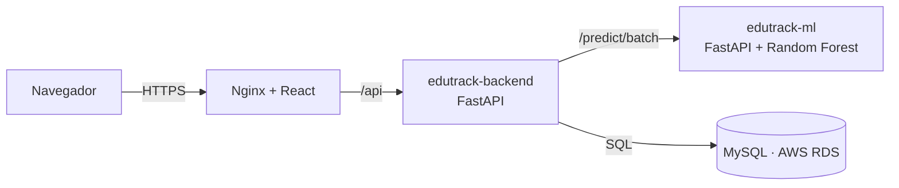

# edutrack-backend

API REST de **EduTrack**, la plataforma de alerta temprana del riesgo de desaprobación y deserción escolar. Incluye la infraestructura de despliegue en AWS (`infra/`) y la documentación técnica (`docs/`).

**Stack:** Python 3.12 · FastAPI · SQLModel · MySQL 8 (AWS RDS) · JWT + RBAC · ReportLab · Docker



📄 [Arquitectura](docs/arquitectura.md) · [Modelo de datos](docs/modelo-datos.md) · [API](docs/api.md) · [ADR-001](docs/adr/ADR-001-multirepo.md)

## Inicio rápido (sin Docker, con SQLite)

Necesitas tener `edutrack-ml` corriendo en el puerto 8001 para las predicciones.

```bash
python -m venv .venv
source .venv/bin/activate          # Windows: .venv\Scripts\activate
pip install -r requirements-dev.txt
cp .env.example .env               # edita SEED_DEFAULT_PASSWORD y JWT_SECRET
python scripts/seed.py             # 1 colegio, 3 aulas, 90 estudiantes, 1 usuario por rol
uvicorn app.main:app --reload
```

Abre http://localhost:8000/docs y usa **Authorize** con un usuario demo.

## Todo el sistema con Docker (MySQL + ML + backend + frontend)

Clona los 3 repos en la **misma carpeta**:

```
edutrack/
├── edutrack-backend/
├── edutrack-ml/
└── edutrack-frontend/
```

```bash
cd edutrack-backend
cp .env.example .env               # completa las claves
docker compose -f infra/docker-compose.yml --env-file .env up --build
docker compose -f infra/docker-compose.yml exec backend python scripts/seed.py
```

| Servicio | URL |
|---|---|
| Frontend | http://localhost:5173 |
| API + Swagger | http://localhost:8000/docs |
| ML service | http://localhost:8001/docs |
| MySQL | `localhost:3307` (usuario `edutrack`; cambia el puerto con `MYSQL_HOST_PORT`) |

> La primera vez el contenedor `frontend` tarda 1–2 minutos en instalar dependencias.

## Usuarios demo (creados por `seed.py`)

Todos usan la contraseña definida en `SEED_DEFAULT_PASSWORD`.

| Email | Rol | Ve |
|---|---|---|
| director@edutrack.pe | director | todo el colegio |
| analista@edutrack.pe | analista | todo; carga CSV, predicción, umbrales |
| tutor1@edutrack.pe | tutor | aula 3° A |
| tutor2@edutrack.pe | tutor | aula 3° B |
| tutor3@edutrack.pe | tutor | aula 4° A |
| docente1@edutrack.pe | docente | Matemática y Ciencia en todas las aulas |
| docente2@edutrack.pe | docente | Comunicación e Inglés en todas las aulas |
| padre@edutrack.pe | padre | solo su hijo (estudiante A0001) |

> Son datos **sintéticos**. Nunca cargues datos reales de menores en entornos de desarrollo (Ley N° 29733).

## Pruebas

```bash
pytest --cov=app --cov-report=term-missing
```

El CI falla si la cobertura baja de **70 %** (IND-05).

## Estructura

```
app/
├── main.py            # app FastAPI, CORS, routers
├── core/              # config (.env) y seguridad (JWT, bcrypt, require_role)
├── models/            # tablas SQLModel
├── schemas/           # DTOs (contrato OpenAPI)
├── routers/           # auth, estudiantes, academico, riesgo, tutoria
├── services/          # acceso (RBAC), features, ml_client, prediccion, pautas, ingesta, reportes
└── seed_data.py       # datos demo
scripts/seed.py
tests/
alembic/               # migraciones
infra/
├── docker-compose.yml       # desarrollo
├── docker-compose.prod.yml  # EC2 + RDS
├── nginx/default.conf
└── scripts/                 # setup-ec2.sh, deploy.sh, init-letsencrypt.sh
docs/
```

## Despliegue en AWS

1. Crea la RDS MySQL (db.t3.micro) en subred privada; su *security group* debe aceptar el puerto 3306 **solo** desde la EC2.
2. Crea la EC2 (t3.medium, Ubuntu 24.04) y ejecuta `infra/scripts/setup-ec2.sh`.
3. En la EC2, clona los 3 repos en `~/edutrack/` y crea `edutrack-backend/.env` con `DATABASE_URL` de RDS y un `JWT_SECRET` fuerte.
4. Ejecuta `infra/scripts/deploy.sh`.
5. Apunta el dominio a la IP de la EC2 y ejecuta `infra/scripts/init-letsencrypt.sh <dominio> <email>`.
6. Despliegues siguientes: **Actions → Deploy a AWS EC2 → Run workflow** (necesita los secrets `EC2_HOST`, `EC2_USER`, `EC2_SSH_KEY`).
