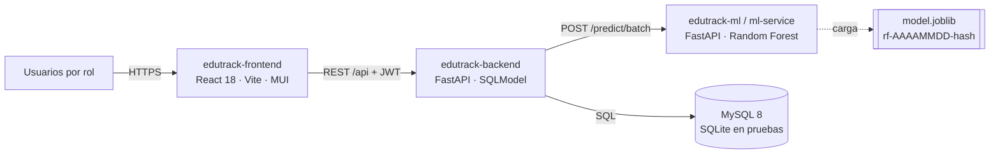
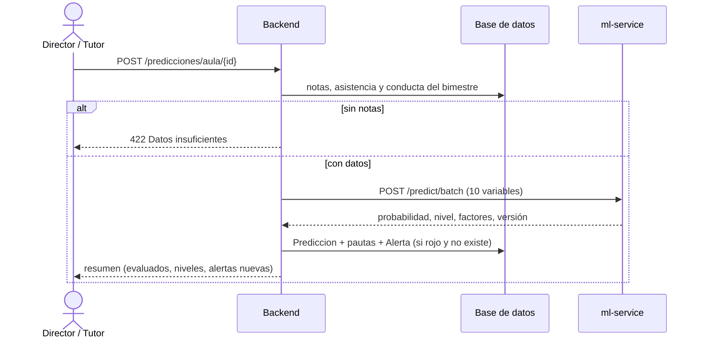

# Arquitectura · EduTrack MVP TB4

Complementa `docs/arquitectura.md` (vista C4 y MVC) con lo implementado en la rama `feature/mvp-tb4`.

## Componentes

| Repositorio | Responsabilidad | Pruebas |
|---|---|---|
| edutrack-frontend | UI por rol, formularios, filtros, portal familiar | Vitest + MSW, Playwright (mocks e integral) |
| edutrack-backend | Autenticación, RBAC, estudiantes, ingesta transaccional, orquestación de predicciones, alertas, pautas | pytest, Locust |
| edutrack-ml | Entrenamiento (`pipeline/`) y servicio de inferencia (`app/`) | pytest + *quality gate* RNF‑02 |

## Decisiones clave
| Tema | Decisión | Motivo |
|---|---|---|
| Autenticación | JWT HS256, 8 h, rol en el *claim*; bcrypt | TB4 HU01 |
| Autorización | `require_role` por endpoint + filtros por aula/hijo en `services/acceso.py` | Evitar fugas entre aulas y familias |
| Carga masiva | Validar todo el archivo y luego insertar en una sola transacción | HU03: «no se inserta ningún registro» si hay error |
| Integridad | Restricciones únicas (nota por estudiante/curso/bimestre, asistencia por fecha, alerta por estudiante/periodo) con migración Alembic | Duplicados D‑03, D‑06 |
| Modelo | `Pipeline(SimpleImputer → SMOTE → RandomForest)`; SMOTE solo dentro de los *folds*; VIF > 5 descarta variables | Evitar fuga de datos |
| Explicación | Oclusión por estudiante contra el perfil mediano sin riesgo, en lote | Factores individuales (D‑04) y rendimiento (D‑09) |
| Versionado del modelo | `rf-AAAAMMDD-hash` guardado en cada predicción | Trazabilidad HU04 |
| Datos insuficientes | El backend no llama al ML si faltan notas del bimestre | HU04 escenario 2 |

## Flujo de predicción

## Modelo de datos (cambios del MVP)
Migración `alembic/versions/0001_inicial_esquema_inicial_mvp_tb4.py`: crea el esquema completo con las restricciones únicas y la columna `modelo_version` en `prediccion`. `tests/test_migraciones.py` verifica que `upgrade` coincide con los modelos y que `downgrade` revierte.
