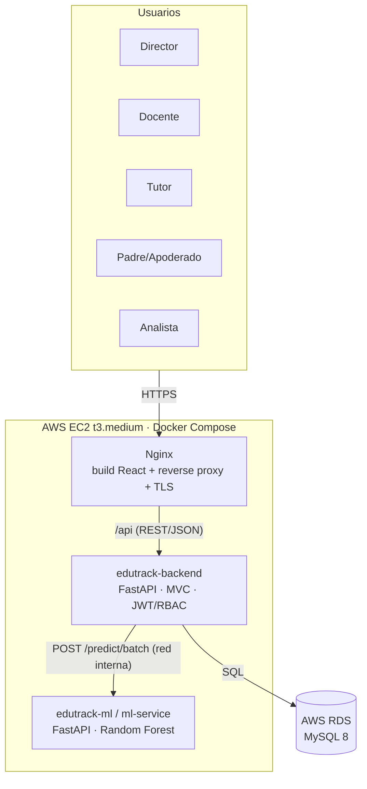
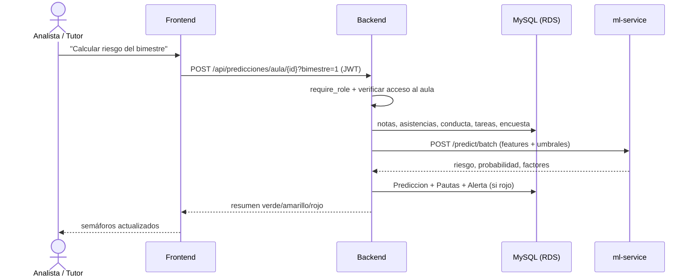

# Arquitectura de solución – EduTrack

Arquitectura web **desacoplada** (MVC + microservicios) desplegada en **AWS**, con seguridad **JWT + RBAC** (Ley N° 29733).

## Vista de contenedores (C4 nivel 2)



| Repositorio | Componente | Tecnología |
|---|---|---|
| `edutrack-frontend` | SPA responsive (dashboard con semáforos, portal de padres) | React + Vite + TypeScript + MUI |
| `edutrack-backend` | API de negocio, seguridad, ingesta, alertas, pautas, reportes | Python 3.12 + FastAPI + SQLModel |
| `edutrack-ml` | Microservicio de predicción + investigación | FastAPI + scikit-learn |

## Vista lógica del backend (MVC)

```
app/
├── routers/    → Controladores (endpoints REST)
├── schemas/    → DTOs de entrada/salida (contrato OpenAPI)
├── models/     → Modelo de datos (SQLModel → MySQL)
├── services/   → Lógica de negocio
│   ├── acceso.py      RBAC a nivel de datos + auditoría
│   ├── features.py    arma las 10 variables para el modelo
│   ├── ml_client.py   cliente HTTP del microservicio ML
│   ├── prediccion.py  orquesta predicción → pautas → alertas
│   ├── pautas.py      generador de pautas pedagógicas por reglas
│   ├── ingesta.py     carga masiva CSV/Excel
│   └── reportes.py    PDF con ReportLab
└── core/       → configuración y seguridad (JWT, bcrypt, require_role)
```

## Flujo de predicción (RF-04 → RF-06)



## Vista física (AWS)

- **EC2 t3.medium** (subred pública): Nginx (80/443), backend (8000, interno) y ml-service (8001, interno).
- **RDS MySQL db.t3.micro** (subred privada): el *security group* solo acepta conexiones desde la EC2. Backups automáticos y cifrado en reposo.
- **TLS** con Let's Encrypt (`infra/scripts/init-letsencrypt.sh`).
- **CI/CD**: GitHub Actions ejecuta los tests en cada PR; el deploy es manual (`workflow_dispatch`) vía SSH.

## Seguridad (IND-03)

| Control | Implementación |
|---|---|
| Autenticación | JWT HS256 con expiración (`JWT_EXPIRES_MINUTES`), contraseñas con bcrypt |
| Autorización por rol | `require_role(...)` en cada endpoint |
| Autorización por datos | `services/acceso.py`: padre → solo su hijo; tutor → su aula; docente → aulas donde dicta |
| Auditoría | Tabla `auditlog` registra quién vio fichas y exportó reportes |
| Secretos | Solo variables de entorno (`.env`, GitHub Secrets) |
| Red | ml-service y RDS no expuestos a Internet |

## Fuera del alcance (MVP)

App móvil nativa, integración con SIAGIE, LMS, módulos financieros y reentrenamiento automático (MLOps).
